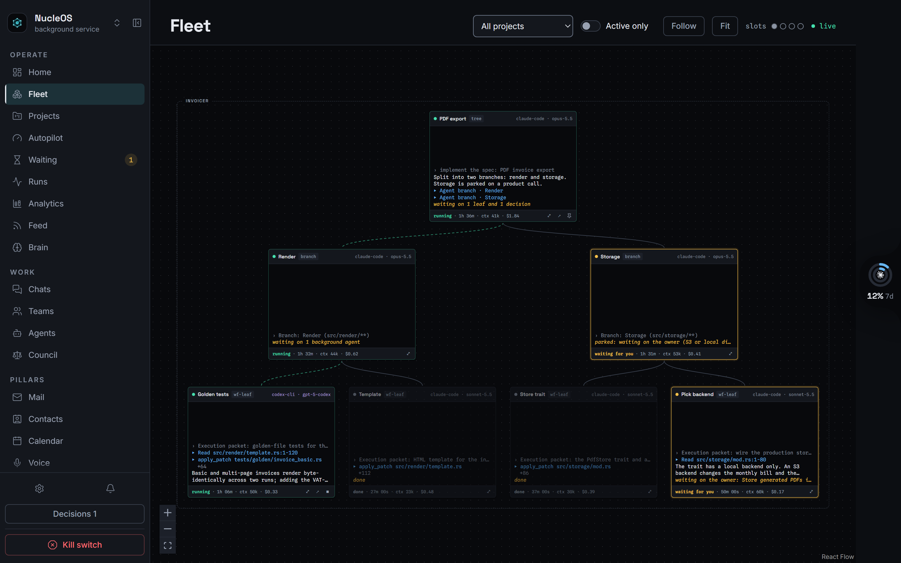
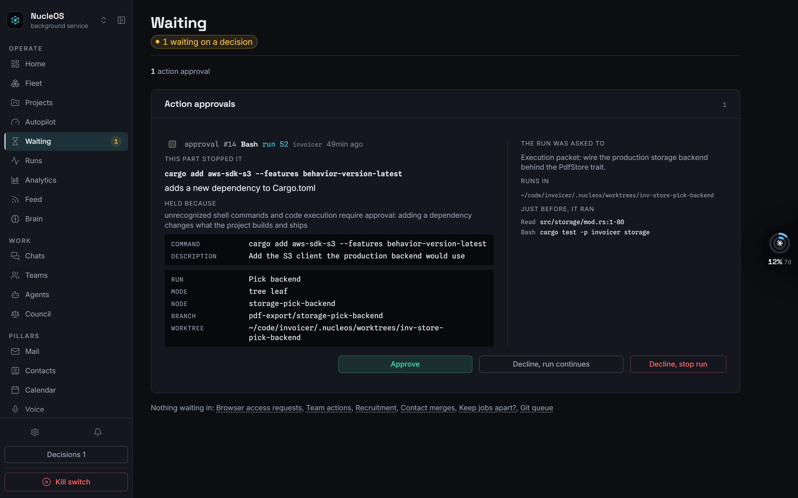
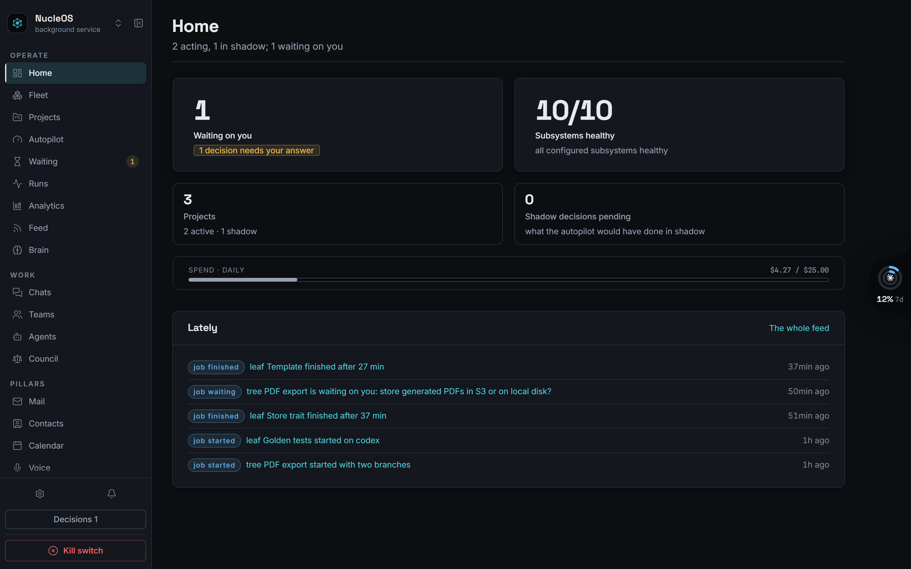

<div align="center">


# NucleOS

**Write the spec. NucleOS runs the agents, verifies the work, lands it — and only wakes you for the decisions that are yours.**

[](https://github.com/zDud4s/nucleos/actions/workflows/ci.yml)
[](LICENSE)


[From spec to master](#from-spec-to-master) ·
[Why not just the agent CLI?](#why-not-just-the-agent-cli) ·
[Architecture](#architecture) ·
[Getting started](#getting-started) ·
[Development](#development) ·
[Security](#security) ·
[License](#license)

</div>

---

NucleOS is the daemon your coding-agent CLIs are missing. It breaks a spec into a tree of
[Claude Code](https://docs.claude.com/en/docs/claude-code), [Codex](https://github.com/openai/codex)
or local-model ([Ollama](https://ollama.com)) agents, each in its own git worktree, that survives
restarts and dropped connections. A verification gate and a single merge queue land every branch;
red gates, flaky failures and conflicts get handled on their own, and only product, cost or
irreversible calls reach you — in the app, on Telegram, or in your terminal.

> [!IMPORTANT]
> NucleOS is **pre-release software**. No release has been published yet (the release workflow and
> install scripts are described in [`RELEASING.md`](RELEASING.md)), so for now you build from
> source, and interfaces may change between commits. Windows is the primary platform; every commit
> is also built and tested on Linux and macOS in CI.

## From spec to master

1. **Write a spec.** You answer a spec session one question at a time until the design is pinned down.
   NucleOS keeps the answers as the spec the agents will work from.
2. **Launch it.** `spec_finish` closes the session and `tree_launch` starts the tree (daemon tools your agent session calls).
   NucleOS creates the root node and the worktree it works in.
3. **A tree of agents works in parallel.** Each node decides for itself whether to execute or to
   split into children, and every node runs in its own git worktree.
   Nodes are daemon runs, so the tree resumes headless after a restart or a dropped connection.

<p align="center"></p>
4. **The verify gate runs.** When a node finishes, the scoped checks for what it touched run in the
   daemon, not in the agent.
   A red gate is retried once before anyone is asked.
5. **The merge queue lands it.** One branch at a time reaches `master`; agents never push. If
   `master` goes red, the merge is reverted and becomes an incident that launches its own fix tree.
6. **What is yours reaches you.** Owner decisions (product, cost, irreversible calls) and risky
   actions held for approval go to the app, Telegram or your terminal. Everything else keeps going.
   Answering wakes the tree where it stopped.

<p align="center"></p>

<p align="center"></p>

The Home view answers "is everything fine?" at a glance.

*Screenshots use the shell's preview mode with a fictional demo project.*

## Why not just the agent CLI?

| | |
|---|---|
| **Durable agent trees** | Adaptive depth: a node executes or splits. Nodes are daemon runs and resume headless after a restart. |
| **Gate and merge queue in the daemon** | Agents never push. A red `master` is reverted and becomes an incident. The resolver retries a failed gate before asking a person. A risk classifier holds risky tool calls as proposals; in shadow mode a project only proposes and never acts. |
| **Decisions as a queue** | The tree stops only for owner calls. Everything waiting on you lands in one place to approve, reject or answer. |
| **Accounts and cost** | A multi-account pool per provider, quota-aware pause and resume, a model chosen per task, spend budgets and a kill switch. |
| **The agent lives on the tower** | Sessions are hosted by the daemon. Use them from a phone or laptop over Tailscale, with voice dictation. See [`REMOTE_ACCESS.md`](REMOTE_ACCESS.md). |

## Built with itself

NucleOS is developed with NucleOS: its own specs run as agent trees and land through its own gate and merge queue, so every feature described here is exercised daily on this repository.

## Architecture

```
┌──────────────────────────────────────┐
│ shell/   Tauri v2 + React            │  Thin client. Holds no state of its own.
└──────────────────┬───────────────────┘
                   │ HTTP + WebSocket · localhost · bearer token
┌──────────────────▼───────────────────┐
│ core/    nucleos-core  (Rust)        │  Scheduler, runs, classifier, git queue.
│                                      │  The only process that writes SQLite.
└──────┬───────────────────────┬───────┘
       │ spawns                │ supervises
┌──────▼───────────┐   ┌───────▼──────────────────────────────────┐
│ agent runner     │   │ sidecars/  (Go)                          │
│ Claude Code,     │   │ email · web · browser · quota · remote   │
│ Codex, local …   │   │ telegram (channel adapter)               │
│ one per run, in  │   └──────────────────────────────────────────┘
│ its own worktree │
└──────────────────┘
```

**Design invariants**

- Only the daemon writes the database. Sidecars never open it.
- Secrets are kept in the OS credential store (currently the Windows Credential Manager), never in
  plain files.
- The local API binds to localhost and requires a bearer token.
- Each integration is its own process and fails on its own.

The daemon is a Cargo workspace: `core/` plus the `nucleos-base`, `nucleos-app` and `nucleos-daemon`
crates under `core/crates/`. The `nucleos-daemon` package builds the `nucleos-core` executable.

The module map and extension points are documented in [`core/MODULE_MAP.md`](core/MODULE_MAP.md) and [`core/AGENTS.md`](core/AGENTS.md). The
threat model is in [`THREAT_MODEL.md`](THREAT_MODEL.md).

## Getting started

### Prerequisites

| Tool | Version |
|---|---|
| Rust | Pinned in [`rust-toolchain.toml`](rust-toolchain.toml); installed by rustup |
| Go | 1.26 |
| Node.js | Current LTS |
| Python | 3.x |
| An agent runner | At least one: `claude` (Claude Code) or `codex` on `PATH` and logged in, or a local model served by Ollama |
| Tauri v2 | Platform prerequisites from [v2.tauri.app](https://v2.tauri.app/start/prerequisites/) |

Run `scripts/doctor.sh` to check your environment. It reports each missing tool and how to install
it.

<details>
<summary><strong>Windows notes</strong></summary>

- Run the scripts from **Git Bash**. On many machines the `bash` on `PATH` is WSL, which does not
  have this toolchain.
- The tested Rust host is GNU: `rustup set default-host x86_64-pc-windows-gnu`.
- Install the Rust toolchain on a path without spaces. A space in the profile path breaks the GNU
  linker.

</details>

### Build and run

```sh
git clone https://github.com/zDud4s/nucleos.git
cd nucleos

# Daemon and sidecars
cargo build -p nucleos-daemon
scripts/build-sidecars.sh
cargo run -p nucleos-daemon
```

In a second terminal:

```sh
cd shell
npm install
npm run tauri dev
```

On Windows, use `powershell -File scripts/run-daemon.ps1` instead of `cargo run`. It runs a copy of
the binaries, so the running daemon does not lock the files your next build needs to replace.

### Add a project

Open **Projects** in the shell and add a repository. Onboarding installs the classifier hook in the
project; for Claude Code that means its `.claude/settings.json`. Until the project is onboarded,
autopilot will not act on it.

## Repository layout

| Path | Contents |
|---|---|
| [`core/`](core) | The daemon, `nucleos-core` (Rust), and its crates under `core/crates/` |
| [`core/hooks/`](core/hooks) | Source of the classifier hook, compiled into the daemon |
| [`sidecars/`](sidecars) | One Go module per integration |
| [`shell/`](shell) | Desktop client (Tauri + React) |
| [`scripts/`](scripts) | Quality gates, diagnostics, build and install helpers |

## Development

`scripts/gates.sh` defines what green means, and CI runs the same script:

```sh
scripts/gates.sh            # everything
scripts/gates.sh core       # one target: core | sidecars | shell | tauri | hooks | security | broker
```

What works on each operating system is tracked in [`PLATFORM_SUPPORT.md`](PLATFORM_SUPPORT.md).
Read [CONTRIBUTING.md](CONTRIBUTING.md) before opening a pull request.

## Security

Please do not report vulnerabilities in public issues. Use a
[private security advisory](https://github.com/zDud4s/nucleos/security/advisories/new) instead.

## License

Licensed under the [Apache License, Version 2.0](LICENSE).

The fonts bundled in [`shell/src/assets/fonts/`](shell/src/assets/fonts) are distributed under the
SIL Open Font License 1.1. Each licence file sits next to its font.
